# docker-node-hardened

[](https://github.com/WilliamSoaresCosta/docker-node-hardened/actions/workflows/ci.yml)

Uma API Node bem simples numa imagem Docker que passa no Trivy sem nenhum HIGH ou CRITICAL.

No primeiro deploy dessa API o Trivy reprovou a imagem com 26 vulnerabilidades. A API não tem
nenhuma dependência, então nenhuma delas era do código. Estava tudo na imagem base: npm, yarn e
corepack que a aplicação nem usa, pacotes do Alpine desatualizados e o Node 20, que já estava sem
suporte.

Podia ter colocado tudo num `.trivyignore` e seguido. Preferi resolver. Contei a história
completa aqui: [26 vulnerabilidades e nenhuma era do meu código](https://williamsoares.com/blog/imagem-docker-26-vulnerabilidades).

<p align="center"></p>

## O que mudei no Dockerfile

- multi-stage: o `npm ci` roda num estágio separado e só o `node_modules` vai para a imagem final
- npm, yarn e corepack removidos da imagem final
- `apk upgrade` para pegar as correções do Alpine
- Node 22 LTS no lugar do 20
- roda com o usuário `node`, não root
- healthcheck

O [Dockerfile](./Dockerfile) está comentado linha a linha.

## Pipeline

Em todo PR e push na main: testes, build, Trivy e um teste rápido que sobe o container, chama o
`/health` e confere que não está rodando como root. Se o Trivy achar HIGH ou CRITICAL com
correção disponível, para ali.

O Trivy é baixado do release oficial com versão fixa e o checksum é conferido antes de rodar. Não
uso action de terceiro para isso.

Quando crio uma tag `v*`, a imagem é publicada no GitHub Container Registry usando o
`GITHUB_TOKEN` do próprio run.

## Rodando local

```bash
npm test

docker build -t docker-node-hardened .
docker run --rm -p 3000:3000 docker-node-hardened

curl localhost:3000/health
curl localhost:3000/version
```

Para conferir o scan:

```bash
trivy image --severity HIGH,CRITICAL --ignore-unfixed docker-node-hardened
```

## A API

Node puro, sem framework. Tem `/health` para as probes do Kubernetes e `/version` para saber qual
build está rodando. No `SIGTERM` ela termina as requisições em andamento antes de sair.

Essa imagem é a que roda no [gitops-argocd-eks](https://github.com/WilliamSoaresCosta/gitops-argocd-eks).
